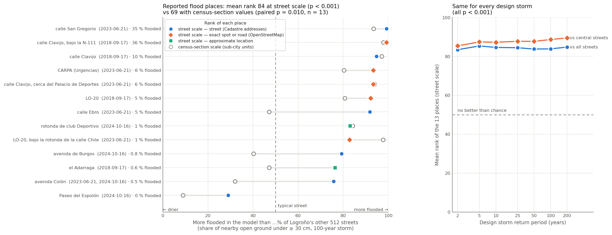
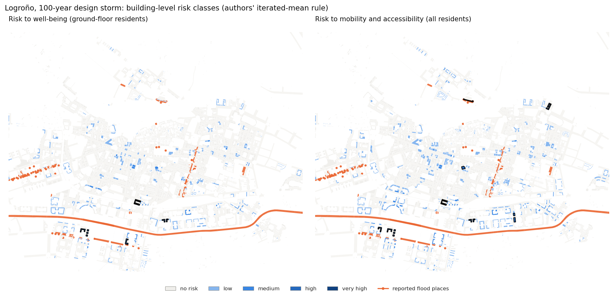

# Building-level pluvial flood risk in Logroño, tested against recorded flood impacts

> **Replicated paper:** Vogelbacher, A., von Szombathely, M., Lennartz, M., Poschlod, B. and Sillmann, J. (2026).
> *A high-resolution framework for urban pluvial flood risk mapping.* Natural Hazards and Earth System Sciences 26, 2765–2783.
> [doi:10.5194/nhess-26-2765-2026](https://doi.org/10.5194/nhess-26-2765-2026)

The paper maps urban pluvial flood risk building by building (social vulnerability × exposure × hazard) and argues that this finer granularity "has the potential to significantly enhance the accuracy of urban risk assessments" compared with sub-city statistical units. Its worked example is a synthetic Hamburg city quarter, reproduced exactly in the [Hamburg reproduction](https://github.com/annefou/hamburg-pluvial-flood-replication).

This FORRT **replication** transfers the framework to a new city, **Logroño (Spain)**, using **open data only** — REACHOUT pluvial flood maps (the paper itself names them as a basis for transfer), the Spanish Cadastre, the INE 2021 census and Copernicus Urban Atlas — and tests the accuracy claim against reality: the **places where storms caused flooding in 2018–2024**, collected from local press reports. Risk is computed for all 6,315 buildings with [`building-climate-risk`](https://github.com/annefou/building-climate-risk) v0.2.0, the open implementation that reproduces the authors' Hamburg example.



*How to read it:* each row is a place where a storm caused flooding. The position says how much more flooded it is in the model than Logroño's other streets (0 = driest, 100 = most flooded; the dashed line is a typical street). Filled markers use street-scale values, hollow circles the census-section average — the longer the line to the right, the more the finer scale helps. The right panel repeats the street-scale test for every design storm.

## Result

- **The flood hazard locates recorded impacts.** The 13 distinct places reported flooded rank on average at the **84th percentile** of the 512 other streets by modelled flooding (≥ 30 cm, 100-year storm; one-sided permutation test p ≤ 0.0001); 12 of 13 are above the median street, and the result holds for every design storm from 2 to 200 years.
- **Finer granularity is what makes the difference.** The same flood map summarised per census section — the sub-city units the paper moves away from — places the same locations clearly less well: 69th vs 84th percentile, 9 of 13 places better at street scale (exact paired test p = 0.010).
- **The building-level risk indices agree only weakly** with the recorded places (61st–68th percentile, p = 0.02–0.16). This is expected by design: several reported places are roads and an underpass with no residents beside them, where the framework rightly gives high hazard but low risk to residents.

- **Social vulnerability, as the paper defines it, mostly re-counts residents.** The indicators are counts per building (number of children, of elderly people living alone, …), so the vulnerability index follows building size almost exactly (rank correlation 0.96 with residents), and building size enters risk twice (vulnerability × exposure). With census rates instead of counts the correlation vanishes (0.06); the risk ranking is unchanged, but the number of hotspot buildings rises from 5 to 21 (well-being) and from 10 to 28 (mobility).

**Verdict: partially supported.** What could be tested — the hazard component, at building / street scale versus sub-city units — supports the paper's claim. What could not be tested is equally explicit: recorded impacts say *where* water caused trouble, not *who* was affected, so **social vulnerability was not tested**, exposure only indirectly, and the accuracy of the building-level risk classes remains unvalidated. Testing them needs impact data on people (e.g. emergency calls or evacuations by address).



The notebooks run the whole pipeline: [download](notebooks/01_data_download.ipynb) the open data (checksummed, with a source log), [prepare](notebooks/02_data_clean.ipynb) buildings, census proxies, streets, flood extents and the reported places, [analyse](notebooks/03_analysis.ipynb) risk, robustness and the impact tests, and draw the [figures](notebooks/04_figures.ipynb). All transfer choices and deviations from the paper are listed in the notebooks and in the FORRT Replication Study.

## Run it

```bash
git clone https://github.com/annefou/logrono-pluvial-flood-replication.git
cd logrono-pluvial-flood-replication
pixi install
pixi run snakemake --cores 1
```

No credentials are needed. A fresh clone regenerates every result table and figure byte-identical to the committed ones (about 20 minutes, mostly downloading).

## Credits

Paper and method: Anastasia Vogelbacher, Malte von Szombathely, Marc Lennartz, Benjamin Poschlod, Jana Sillmann. Flood maps: Andrea Staccione, Jeremy S. Pal (REACHOUT, CC BY 4.0). Buildings, parcels and addresses: derived from data of the Dirección General del Catastro (Catastro INSPIRE licence of access and use, 2016; the original files are not redistributed). Census: Instituto Nacional de Estadística. Urban Atlas: European Environment Agency (Copernicus Land Monitoring Service). Impact places without an address: © OpenStreetMap contributors (ODbL). Replication and `building-climate-risk`: Anne Fouilloux (LifeWatch ERIC).

## Nanopublication chain

The FORRT chain is published on Science Live (2026-10-10): [Quote](https://w3id.org/sciencelive/np/RAbgREdIegl6pbTP_E4E2Eg9JR28whinZDteeGueXg1Wc) → [AIDA](https://w3id.org/sciencelive/np/RAPjP2vEln1AzhH3QpkUK6lRB99xicwcRkdUp35bxk9U4) → [Claim](https://w3id.org/sciencelive/np/RAQDtKtTjDH3tbUuBwmzk2mWYe7vyMKHMI1cquwB-Pltk) → [Replication Study](https://w3id.org/sciencelive/np/RABBJpiR9zQUaRlSclmmv5wvIJr8wWl_hyo-NBK2o10pI) → [Outcome: partially supported](https://w3id.org/sciencelive/np/RAzO2FoYqdwvPCDDkfVmf-SKOl2mUpsf_qZeje0i_LP_U) → [CiTO: qualifies the paper, extends the Hamburg chain](https://w3id.org/sciencelive/np/RAoFYugT7OVk5eoHuxKCO9HeqA08jMfSn7TeUxwZcbezE). All URIs: [`nanopubs/PUBLISHED.md`](nanopubs/PUBLISHED.md). The paper's geographical coverage is already published: [Hamburg, Germany](https://w3id.org/sciencelive/np/RA1NTaGnBgz1AFkx-Xbpl8FLq16t6wINM-XyP4PrsXnK8) (mainland outline from OpenStreetMap). Logroño, this replication's study area, is published too: [Logroño, La Rioja, Spain](https://w3id.org/sciencelive/np/RAzds1z9t2ac7XFvx_Hsv18__p5nUTNA0NHIsskSyLVPQ) (municipal boundary from OpenStreetMap). Climate-change and adaptation scenarios for Logroño are planned in a separate repository ([`FOLLOW-UP.md`](FOLLOW-UP.md)).

## Citation

If you use this work, please cite both:

- This software: [`CITATION.cff`](CITATION.cff) → DOI [10.5281/zenodo.23284600](https://doi.org/10.5281/zenodo.23284600) (v0.1.1: [10.5281/zenodo.23285198](https://doi.org/10.5281/zenodo.23285198)).
- The original paper: [10.5194/nhess-26-2765-2026](https://doi.org/10.5194/nhess-26-2765-2026).
